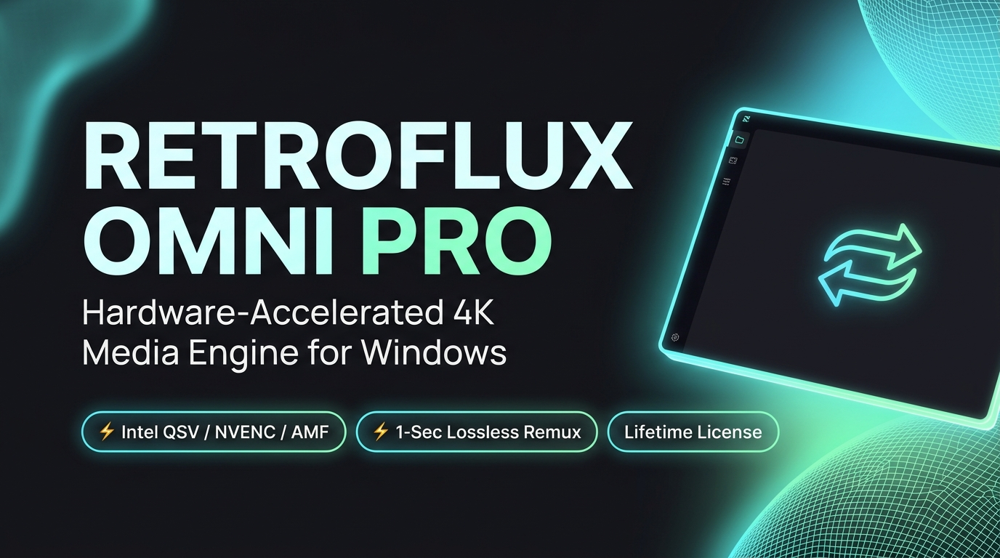
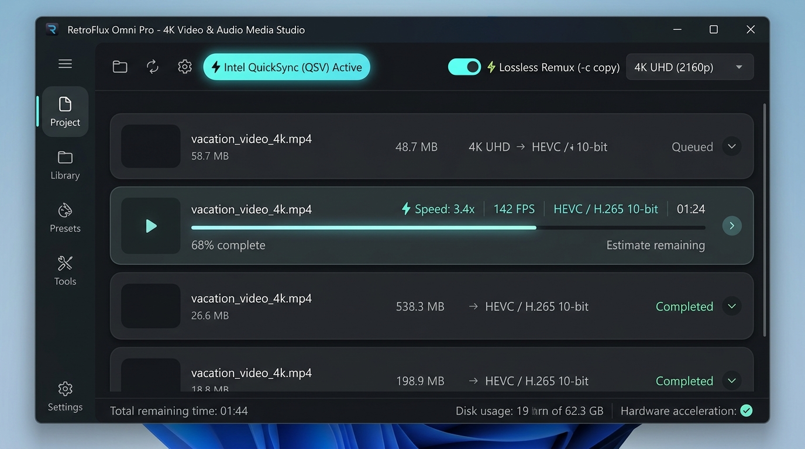
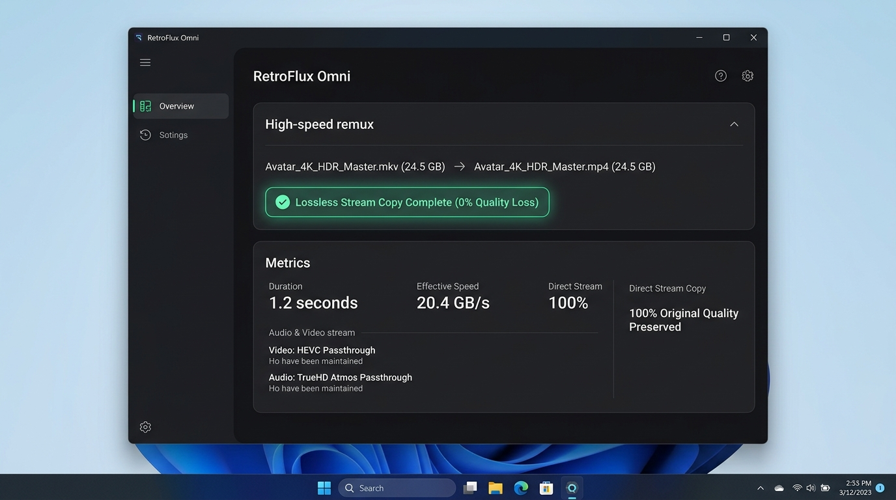

# RetroFlux Omni

<p align="center">
  
</p>

<p align="center">
  <strong>Dedicated High-Performance 4K Media Conversion & Transcoding Studio</strong><br />
  <em>Hardware-Accelerated Intel QSV, NVIDIA NVENC & AMD AMF Silicon • 1-Second Lossless Remux</em>
</p>

<p align="center">
  <a href="https://bonnokush.github.io/RetroFlux-Omni/"><strong>🌐 Live Website</strong></a> · 
  <a href="https://retroflux.lemonsqueezy.com/checkout/buy/retroflux-omni-pro"><strong>🍋 Buy Pro ($29 Lifetime)</strong></a> · 
  <a href="#-1-click-powershell-installer-windows"><strong>⚡ 1-Click Install</strong></a> · 
  <a href="https://github.com/bonnokush/RetroFlux-Omni/releases"><strong>📦 GitHub Releases</strong></a>
</p>

---

## ⚡ 1-Click PowerShell Installer (Windows)

Run the following command in PowerShell (Run as Administrator or standard user) to automatically download, unblock (bypassing Smart App Control MOTW flags), configure FFmpeg, and install RetroFlux Omni with Desktop and Start Menu shortcuts:

```powershell
irm https://raw.githubusercontent.com/bonnokush/RetroFlux-Omni/main/install.ps1 | iex
```

---

## 📸 Screenshots & Interface

<p align="center">
  
</p>
<p align="center">
  <em>⚡ RetroFlux Omni — Dedicated 4K Ultra HD Transcoding & Autodetected Silicon GPU Acceleration</em>
</p>

<p align="center">
  
</p>
<p align="center">
  <em>⚡ Instant 1-Second Lossless Remuxing (-c copy) & Google Pixel Material You Interface</em>
</p>

---

## ⚡ Key Highlights

### 1. Hardware-Accelerated 4K Video Transcoding
- **Automatic GPU Detection**: Intelligently inspects host hardware and unlocks silicon encoding chips:
  - **Intel Iris Xe / Arc**: Intel QuickSync Video (`hevc_qsv`, `h264_qsv`, `av1_qsv`) via `-hwaccel qsv`
  - **NVIDIA GeForce / RTX**: NVENC (`hevc_nvenc`, `h264_nvenc`, `av1_nvenc`) via `-hwaccel cuda`
  - **AMD Radeon**: AMF (`hevc_amf`, `h264_amf`) via `-hwaccel d3d11va`
  - **Multi-Threaded CPU Fallback**: `libx265` and `libx264` with `-threads 0`
- **Resolution Scaling**: Presets for 4K UHD (2160p), 1440p QHD, 1080p FHD, 720p HD, and Original Source.

### 2. ⚡ Instant Lossless Remuxing (`-c copy`)
- Swap video containers (e.g. `MKV` &rarr; `MP4`, `MOV` &rarr; `MP4`, `TS` &rarr; `MKV`, `WebM` &rarr; `MP4`) in **1–2 seconds for 20GB+ 4K files**.
- Direct bitstream copying (`-c:v copy -c:a copy -map 0`) with zero quality loss and zero CPU re-encoding strain.

### 3. High-Fidelity Audio Extraction & Encoding
- Extract or transcode pure audio tracks directly from videos:
  - **MP3**: 320 kbps high-bitrate LAME stereo
  - **FLAC**: Lossless compression
  - **WAV**: Uncompressed PCM 16-bit
  - **AAC / M4A**: 256 kbps studio audio
  - **Opus / OGG**: Modern 192 kbps voice and music codec

### 4. Real-Time Telemetry & Progress
- Dynamic percentage parsing ($\text{Current Time} / \text{Total Duration}$).
- Real-time transcoding metrics: **FPS** (e.g., `142 FPS`), **Encoding Speed** (e.g., `⚡ 3.4x`), and active encoder label.

### 5. Multi-Threaded Image Studio
- Background Dart isolate pool for non-blocking multi-core image conversion and compression (PNG, JPG, WebP, BMP, ICO).

### 6. Google Pixel Material 3 (Material You) Design
- Dynamic tonal surface hierarchy (`surfaceContainerLow`, `surfaceContainer`, `surfaceContainerHigh`) with zero synthetic 1px borders.
- Smooth 24px–28px container radii and stadium pills (`BorderRadius.circular(100)`).
- Embedded native **Product Sans** TrueType typography.
- 5 built-in Google Pixel seed palettes (Bay Blue, Sage Green, Obsidian Lavender, Terracotta, Amber Gold) plus dynamic OS wallpaper extraction.

---

## 📁 Where is the Executable?

Once built, the standalone executable and its companion dependencies are located in:

### Standalone Executable Directory
```
C:\Projects\RetroFlux-Omni\build\windows\x64\runner\Debug\retroflux_omni.exe
```
> **Distribution Note**: Like all native Windows Flutter applications, `retroflux_omni.exe` runs alongside `flutter_windows.dll`, plugin DLLs, and the `data/` asset folder. Use the 1-click installer (`install.ps1`) to automatically deploy all dependencies into `%LOCALAPPDATA%\Programs\RetroFlux-Omni` and create shortcuts.

---

## 🍋 Lemon Squeezy Licensing & Store

RetroFlux Omni supports online license verification via **Lemon Squeezy** with 100% offline fallback:
- **Store Checkout**: [Buy RetroFlux Pro on Lemon Squeezy ($29 Lifetime)](https://retroflux.lemonsqueezy.com/checkout/buy/retroflux-omni-pro)
- **API Activation**: Connects to `https://api.lemonsqueezy.com/v1/licenses/activate`.
- **Perpetual Offline Caching**: Once verified, HMAC-SHA256 encrypted tokens are saved locally so users can work completely air-gapped with 4K UHD enabled.
- **Deactivation**: Frees up activation seats via `/licenses/deactivate` to transfer licenses between devices.

---

## Architecture Overview

```
RetroFlux-Omni/
├── assets/
│   └── fonts/                 # Embedded Google Product Sans TTF font family
├── docs/                      # GitHub Pages static entrypoint & documentation
├── install.ps1                # 1-Click Automated Windows PowerShell installer
├── lib/
│   ├── core/
│   │   ├── engine_bridge.dart    # High-performance 4K FFmpeg & GPU hardware dispatcher
│   │   ├── license_service.dart  # Lemon Squeezy API & HMAC offline license engine
│   │   ├── theme_controller.dart # Reactive Material You dynamic theme & Pixel seeds
│   │   └── worker_isolate.dart   # Background isolate worker pools for zero UI blocking
│   ├── ui/
│   │   ├── adaptive_scaffold.dart# Responsive Google Pixel navigation drawer & layout
│   │   ├── dashboard_screen.dart # Universal Drag-and-Drop Drop Zone & Batch Queue
│   │   ├── palette_switcher.dart # Live Material You accent palette & theme modal
│   │   ├── pro_modal.dart        # PRO tier activation dialog & Lemon Squeezy checkout
│   │   ├── theme.dart            # M3 dark/light tonal tokens & color palette
│   │   └── studios/
│   │       ├── media_studio.dart # 4K Video Transcoder & Lossless Remux Studio
│   │       ├── image_studio.dart # Image Studio & Multi-format Compressor
│   │       └── history_view.dart # Export history & file reveal manager
│   └── main.dart                 # Application entry point with DynamicColorBuilder
├── scripts/
│   └── Install-RetroFlux.ps1     # Native Windows PowerShell installer script
├── test/
│   ├── e2e_ui_audit_test.dart        # End-to-end automated UI & queue audit
│   ├── material_you_theme_test.dart  # Theme controller & palette switching tests
│   ├── media_and_studios_test.dart   # 4K Media Studio & hardware capability tests
│   └── widget_test.dart              # Cryptographic license verification tests
├── website/                   # High-converting product landing page & screenshots
│   ├── screenshots/           # High-resolution UI screenshots
│   ├── index.html             # Tailwind CSS + Material 3 product landing page
│   ├── lemonsqueezy-cover.png # 1280x720 Lemon Squeezy product cover banner
│   └── retroflux-icon.png     # 1024x1024 high-res app icon
└── pubspec.yaml
```

---

## Getting Started

### Prerequisites
- **Flutter SDK**: `>= 3.24.0` (Dart SDK `>= 3.5.0`)
- **Desktop C++ Build Tools**: Visual Studio 2022 (with "Desktop development with C++") on Windows.
- **FFmpeg**: Automatically detected via WinGet (`winget install Gyan.FFmpeg`) or system `PATH`.

### Dependency Setup
```powershell
cd C:\Projects\RetroFlux-Omni
flutter pub get
```

### Running the App
```powershell
flutter run -d windows
```

---

## License & Tiers
- **Free Tier**: Up to 3 batch queue items, 1080p FHD resolution cap, standard codecs.
- **PRO Tier**: Unlimited batch queue, **4K UHD (2160p)** resolution export, **Intel QSV / NVIDIA NVENC / AMD AMF hardware acceleration**, and AV1/HEVC modern codecs.
